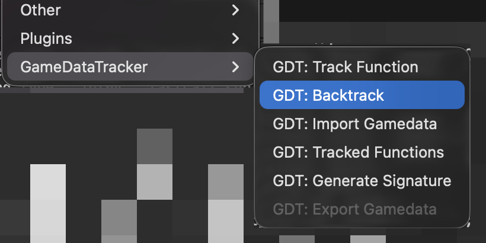
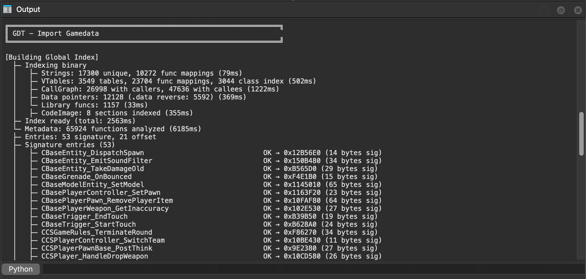
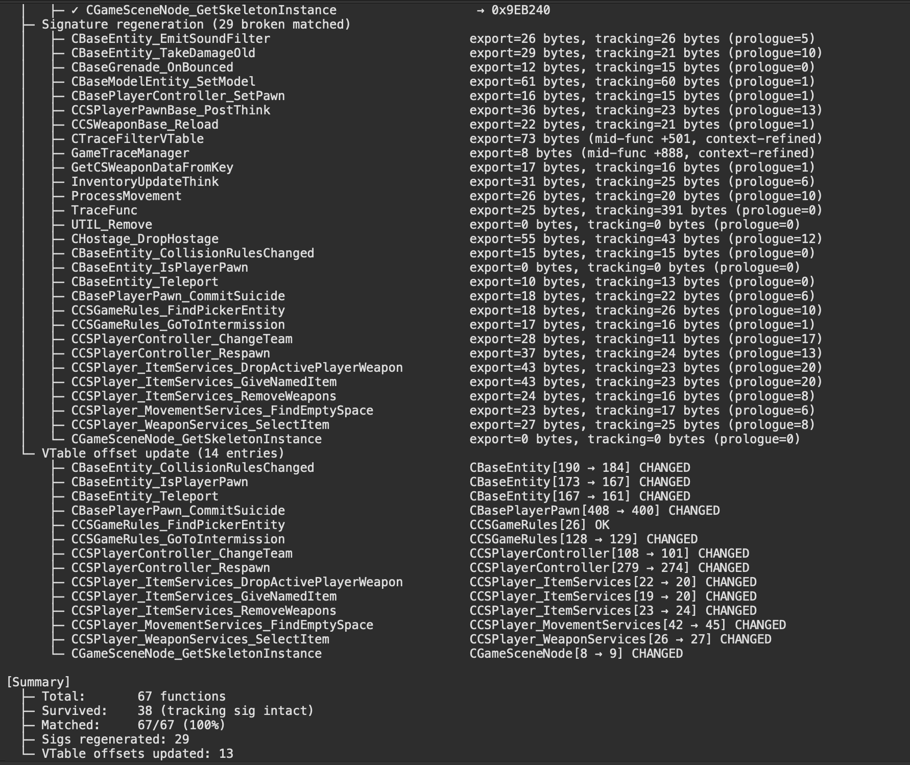
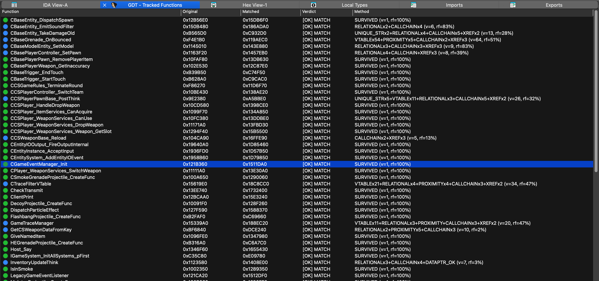
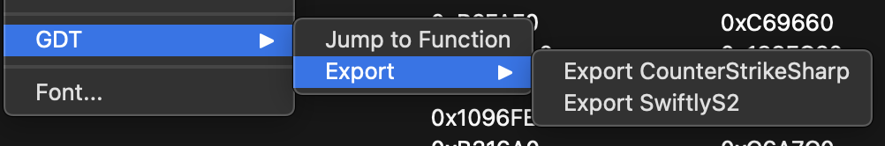

# IDA-GameDataTracker

**GameDataTracker** — an IDA Pro plugin for tracking game functions across binary updates. Update all your gamedata dependencies in minutes, not hours.

Built for Source Engine community plugin and mod development. Crawl functions to collect anchors (signatures, strings, vtables, convars, etc.), serialize them, then use the pathfinder to relocate those same functions in updated binaries. Supports mid-function signature matching — not just function prologues, but specific lines deep inside a function body can be tracked and relocated across updates. Also tracks vtable offsets: if the function name contains the vtable class name before the last `_` (e.g. `CBaseEntity_Teleport`), the plugin automatically detects and updates the vtable offset across binary versions. Export directly to CounterStrikeSharp and SwiftlyS2 gamedata formats.

[](https://github.com/K4ryuu/IDA-GameDataTracker)
[](LICENSE)

## Support

If you find this useful, consider sponsoring the development:

[](https://github.com/sponsors/K4ryuu)

**Repository**: [github.com/K4ryuu/IDA-GameDataTracker](https://github.com/K4ryuu/IDA-GameDataTracker)

## Features

- **Modular crawler** with 10 independent anchor modules
- **Multi-pass parallel pathfinder** with identity gate and reinforcement scoring
- **Gamedata export** for CounterStrikeSharp and SwiftlyS2
- **Auto-save/load** of tracking data between sessions
- **Mid-function signature support** for more resilient matching
- **VTable offset tracking** across updates
- **Tree-style logging** for readable output
- **Cross-platform** builds (Linux, macOS, Windows)

## Platform Support

| Platform | Architecture | Status |
|----------|-------------|--------|
| IDA Pro 9.x | Required | Base requirement |
| Linux | x64, ARM64 | Native build |
| macOS | Intel, Apple Silicon | Native build |
| Windows | x64 | Cross-compile |

## Installation

Copy the built plugin to your IDA plugins directory:

| Platform | Path |
|----------|------|
| **Linux** | `~/.idapro/plugins/gdt64.so` |
| **macOS** | `~/.idapro/plugins/gdt64.dylib` |
| **Windows** | `%APPDATA%\Hex-Rays\IDA Pro\plugins\gdt64.dll` |

## Quick Start

Once installed, actions are available under **Edit > GameDataTracker**.



Typical workflow:

1. You have an existing gamedata JSON with known-good offsets/signatures
2. Open the **last known good binary** in IDA (the version your gamedata was built for)
3. **Import** the gamedata — the plugin imports and renames all functions automatically



4. The crawler runs on every imported function and generates a clue file next to the binary
5. Open the **new binary version** in IDA
6. Run **Backtrack** and browse to the clue file from the old binary's folder
7. The pathfinder relocates all tracked functions in the new binary



8. View results in the tracked functions list and export fresh gamedata — done





You can also track functions manually without importing.

## How It Works

The plugin operates in two phases:

**Crawling** — For each tracked function, the crawler runs its modules to collect anchors: signatures, strings, convar references, vtable entries, library metadata, relational info, and more. This data is serialized to JSON.

**Pathfinding** — When loaded against a new binary, the pathfinder uses collected anchors to relocate functions. It runs multiple passes with parallel matching, applies an identity gate to filter false positives, and uses reinforcement scoring to rank candidates.

### Crawler Modules

| Module | What it collects |
|--------|-----------------|
| **Signature** | Byte patterns (including mid-function) |
| **String** | Referenced string literals |
| **ConVar** | Console variable references |
| **VTable** | Virtual table offsets and entries |
| **Library** | Library/segment metadata |
| **Relational** | Cross-references between tracked functions |
| **DataPtr** | Data pointer references |
| **Proximity** | Spatial relationships to known anchors |
| **CallChain** | Function call sequences |
| **Xref** | Cross-reference patterns |

## Building from Source

Requires the IDA SDK (9.x) placed in `sdk/` at the project root.

```bash
# Build for current platform
make build

# Build and install to local IDA plugins dir
make local

# Cross-compile for Windows
make build-windows
```

See the `Makefile` and `docker/` directory for build details and Docker-based builds.

## Credits

- **[K4ryuu](https://github.com/K4ryuu)** — Author and maintainer

## License

This project is licensed under the MIT License. See [LICENSE](LICENSE) for details.
